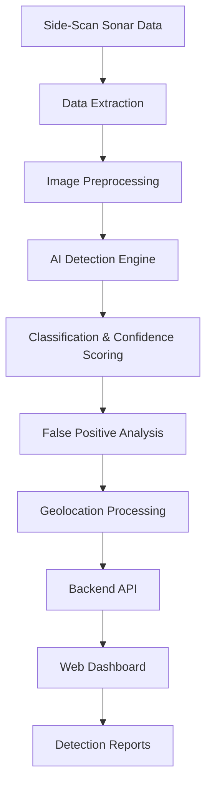

# 🌊 DeepSea Sonar
### AI-Powered Underwater Marine Debris & Anomaly Detection Using Side-Scan Sonar

**DeepSea Sonar** is an AI-powered underwater detection system designed to automate the identification of marine debris and suspicious underwater objects using Side-Scan Sonar (SSS) imagery.

The project aims to reduce the time and effort required for manual sonar image analysis by combining computer vision, deep learning, sonar image processing, and geospatial visualization into a unified detection pipeline.

Instead of manually examining thousands of sonar images, the system aims to identify potential underwater objects, classify detected anomalies, assign confidence scores, and associate detections with their geographical locations.

---

## 📌 Table of Contents

- [Overview](#-overview)
- [Problem Statement](#-problem-statement)
- [Our Solution](#-our-solution)
- [Key Objectives](#-key-objectives)
- [System Architecture](#-system-architecture)
- [Detection Pipeline](#-detection-pipeline)
- [Technology Stack](#-technology-stack)
- [Core Components](#-core-components)
- [False Positive Reduction](#-false-positive-reduction)
- [Geospatial Visualization](#-geospatial-visualization)
- [Potential Applications](#-potential-applications)
- [Project Structure](#-project-structure)
- [Development Roadmap](#-development-roadmap)
- [Team](#-team)
- [Contributing](#-contributing)
- [License](#-license)

---

## 🌐 Overview

Underwater environments contain various objects, including marine debris, discarded fishing equipment, shipwrecks, rocks, and other potentially hazardous structures.

Side-Scan Sonar is widely used to survey underwater environments by producing acoustic images of the seafloor. However, interpreting these images requires considerable expertise and manual effort.

DeepSea Sonar aims to simplify this process through artificial intelligence.

By processing sonar imagery with computer vision and deep learning techniques, the system is designed to:

- Automatically identify potential marine debris and underwater anomalies.
- Detect and classify objects in sonar imagery.
- Distinguish potential debris from natural seabed structures.
- Reduce false-positive detections.
- Associate detected objects with geographical coordinates.
- Present detection results through an intuitive visualization dashboard.

The long-term goal is to support faster, more efficient underwater surveys and marine cleanup operations.

## ❗ Problem Statement

Traditional underwater sonar surveys often depend on experts manually inspecting large volumes of Side-Scan Sonar imagery.

This creates several challenges:

**1. Time-Consuming Analysis**

Manually reviewing extensive sonar recordings requires significant time and specialized knowledge.

**2. Detection Difficulty**

Objects such as plastic debris, fishing nets, metallic waste, and other submerged materials can have varying acoustic signatures.

**3. False Positives**

Natural underwater formations, rocks, seabed textures, and acoustic shadows can resemble man-made objects.

**4. Lack of Automated Classification**

Identifying and categorizing potential underwater debris manually makes large-scale monitoring difficult.

**5. Geographical Identification**

Detecting an object is only part of the process. Knowing where it is located is essential for further inspection and cleanup operations.

## 💡 Our Solution

DeepSea Sonar proposes an integrated AI-based pipeline that processes Side-Scan Sonar imagery and generates structured detection results.

The system combines:

- **Sonar Image Processing:** Enhancing raw sonar imagery to improve object visibility.
- **Deep Learning:** Applying object detection and image segmentation models to identify underwater objects.
- **Anomaly Classification:** Categorizing detected objects and distinguishing potential debris from natural formations.
- **Confidence Scoring:** Assigning confidence values to individual detections.
- **Geospatial Mapping:** Associating detections with geographical coordinates.
- **Visualization Dashboard:** Displaying detected objects and their associated information.

## 🎯 Key Objectives

1. Automate underwater sonar image analysis.
2. Develop an AI-based marine debris detection pipeline.
3. Improve detection reliability through sonar-specific preprocessing.
4. Minimize false positives caused by rocks, shadows, and natural seabed formations.
5. Generate confidence-scored detection results.
6. Enable geographical visualization of detected objects.
7. Explore deployment on Autonomous Underwater Vehicles (AUVs).

---

## 🏗️ System Architecture

The proposed system follows a modular architecture consisting of five major stages.

### Architecture Explanation

| Component | Responsibility |
|---|---|
| Data Input | Receives sonar imagery and associated metadata |
| Preprocessing | Denoises, enhances, and normalizes sonar images |
| AI Engine | Detects potential underwater objects |
| Classification | Categorizes objects and calculates confidence scores |
| Validation | Analyzes potential false positives |
| Geolocation | Associates detections with geographical coordinates |
| Backend | Processes and serves detection results |
| Dashboard | Displays detections, locations, and reports |

---

## ⚙️ Detection Pipeline

### 1. Sonar Data Acquisition

The system accepts Side-Scan Sonar imagery as its primary input.

Depending on the available data source, additional metadata may include:

- GPS coordinates
- Sonar timestamp
- Survey track information
- Sonar frequency
- Sensor configuration

### 2. Image Preprocessing

Raw sonar imagery may contain acoustic noise, speckle patterns, low contrast, and environmental interference.

The preprocessing stage aims to improve image quality before AI inference.

Potential techniques include:

- Image denoising
- Contrast enhancement
- Normalization
- Noise reduction
- Image resizing
- Data augmentation

**Technologies:** Python, OpenCV, NumPy.

### 3. AI-Based Object Detection

The processed sonar images are passed to a deep learning model.

Potential model architectures include:

- **YOLO:** Real-time object detection and bounding-box localization.
- **CNN:** Image feature extraction and classification.
- **U-Net:** Pixel-level segmentation of underwater objects.

The detection engine aims to identify potential targets such as:

- Marine debris
- Discarded fishing equipment
- Submerged artificial objects
- Other underwater anomalies

The final model and detection classes will depend on dataset availability and experimental evaluation.

### 4. Classification & Confidence Scoring

Each detected object is intended to receive:

- Predicted class
- Bounding-box coordinates or segmentation mask
- Detection confidence
- Associated sonar image information

Confidence scores help prioritize detections for further inspection.

### 5. False Positive Reduction

Not every unusual sonar signature represents marine debris.

The system aims to reduce false positives by analyzing additional visual characteristics, including:

- Object shape
- Acoustic shadow geometry
- Brightness distribution
- Texture
- Relative size
- Surrounding seabed characteristics

This stage is particularly important for distinguishing artificial objects from rocks and natural underwater formations.

### 6. Geolocation Processing

Detected objects can be associated with geographical information obtained from sonar survey metadata.

The intended output includes:

- Latitude
- Longitude
- Detection timestamp
- Object classification
- Confidence score
